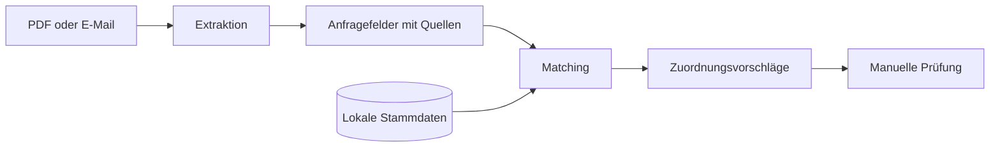
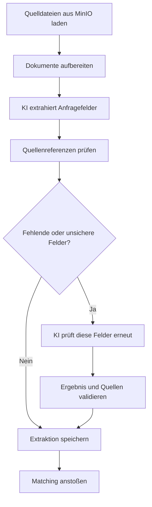
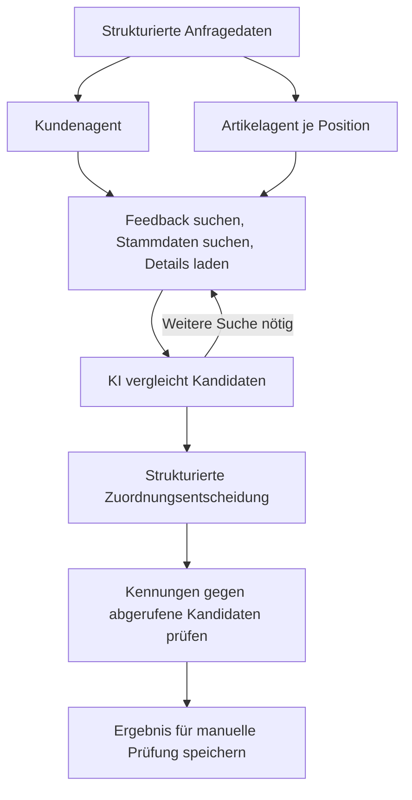

# Architektur des Estaro-PoC

## Ziel und Aufbau

Estaro unterstützt die Bearbeitung von Kundenanfragen aus PDF-Dokumenten und
E-Mails. Die Anwendung extrahiert strukturierte Daten mit KI, gleicht Kunden und
Positionen mit Stammdaten ab und ermöglicht die manuelle Prüfung der Ergebnisse.

Das System besteht aus einer Weboberfläche, einer HTTP-API und separat laufenden
Hintergrundprozessen. API und Worker verwenden dieselben Backend-Module.

| Baustein | Technologie und Aufgabe |
| --- | --- |
| Frontend | React, TypeScript und Vite; TanStack Router für Navigation, TanStack Query für API-Daten und Statusabfragen |
| API | FastAPI mit Pydantic-Modellen; Endpunkte für Anfragen, Dokumente, Extraktion, Matching, Stammdaten, Regeln und Outlook-Anbindung |
| Hintergrundverarbeitung | Celery-Worker für Extraktion, Matching, Outlook-Import und Bereinigung; Celery Beat für periodische Aufgaben |
| Datenbank | PostgreSQL für Fachdaten, Verarbeitungsergebnisse und Jobstatus; SQLModel mit asynchronen Repositories und asyncpg, Alembic für Migrationen |
| Dateispeicher | MinIO für Quelldokumente und Anhänge |
| Aufgabenvermittlung | Redis als Celery-Broker; der fachliche Jobstatus liegt in PostgreSQL |
| Externe Dienste | OpenAI kompatible API für KI-Verarbeitung; Microsoft Graph für den optionalen Outlook-Import über OAuth |

## Backend-Schichten

Die Verzeichnisse unter `backend/app/` trennen die Verantwortlichkeiten:

- `routes/`: HTTP-Schnittstellen und Übergabe an Services über Dependency Injection.
- `services/domain/`: Fachlogik für Anfragen, Dokumente, Prüfungen und Regeln.
- `services/jobs/`: Registrierung, Steuerung und Ausführung von Verarbeitungsjobs.
- `pipelines/`: Verarbeitungsschritte für Extraktion und Stammdatenabgleich.
- `persistence/`: SQLModel-Schemata und asynchrone Repositories, getrennt nach
  Fachdaten (`domain/`) und Jobs (`jobs/`).
- `models/`: Pydantic-Datenmodelle für API, Domäne und Jobkommunikation.
- `services/shared/`: Infrastrukturzugriffe, unter anderem Datenbank,
  Transaktionen, MinIO, OpenAI und Outlook.
- `workers/`: Celery-Konfiguration und Einstiegspunkte der Hintergrundaufgaben.

Im Frontend liegen Seiten in `frontend/src/routes/`, UI-Bausteine in
`components/` und Datenzugriffe in `hooks/` sowie `lib/`. Der generierte
TypeScript-API-Client liegt in `lib/generated/Api.ts`.

## Ablauf einer Anfrage

1. Eine Datei wird hochgeladen oder eine E-Mail über die Outlook-Anbindung
   importiert. Das Backend registriert Anfrage und Dokumente, speichert Dateien
   in MinIO und legt einen Extraktionsjob in PostgreSQL an.
2. Die API übermittelt die Job-ID über Redis an einen Celery-Worker.
3. Die Extraktionspipeline lädt und klassifiziert die Quellen, extrahiert Daten
   mit OpenAI und prüft Felder anhand eines Konfidenzschwellwerts erneut.
   Fachliche Regeln und bestätigte frühere Prüfungen können Kontext liefern.
4. Nach erfolgreicher Extraktion startet der Stammdatenabgleich. KI-Agenten
   suchen über Werkzeuge nach passenden Kunden und Artikeln. Artikelpositionen
   werden mit begrenzter Parallelität verarbeitet.
5. Ergebnisse und Fortschritt werden in PostgreSQL gespeichert. Das Frontend
   fragt den Status regelmäßig ab und zeigt Quelldokumente, extrahierte Felder
   und Zuordnungsvorschläge zur Prüfung an.
6. Anwender können Werte korrigieren und Zuordnungen bestätigen. Revisionen und
   Transaktionen schützen Prüfungen vor konkurrierenden Änderungen; bestätigte
   Ergebnisse können spätere Verarbeitungen als Beispiele unterstützen.

### Extraktionspipeline

`pipelines/extraction/pipeline.py` steuert vier aufeinanderfolgende Schritte und
meldet deren Fortschritt an den Job-Service. Eine E-Mail und ihre zugehörigen
Dokumente werden gemeinsam als Quellen der Anfrage verarbeitet.

1. **Laden (`load`):** Die Quelldateien werden anhand ihrer Speicherschlüssel aus
   MinIO gelesen. Das Backend prüft, ob der Inhalt zum angegebenen Dateityp passt.
2. **Aufbereitung (`document_classification`):** PDFs werden mit Docling in
   strukturierte Dokumentabschnitte und Seitenbilder umgewandelt. Die Abschnitte
   enthalten DocTags für Text und Tabellen sowie eindeutige Abschnittskennungen.
   Seitenzahlen und Positionsrechtecke bleiben als Quelleninformationen erhalten.
   E-Mails werden in Textabschnitte mit eigenen Kennungen zerlegt. Der Schritt
   bereitet die Quellen für die KI vor; er liefert noch keine fachlichen
   Anfragefelder. Die aufwendige PDF-Konvertierung läuft in einem Threadpool.
3. **Extraktion (`extract`):** Das Modell erhält die aufbereiteten Texte und bei
   PDFs zusätzlich die Seitenbilder. Dadurch kann es Tabellen, räumliche
   Zuordnungen und schwer lesbare Textstellen im Bild berücksichtigen. Es liest
   unter anderem Kunden- und Kontaktdaten, Anfragereferenzen, Anforderungen sowie
   Positionen mit Artikelart, Werkstoff, Maßen, Menge und Einheit aus. Die
   ursprüngliche Sprache wird für die Anfrage und je Position erfasst. Der
   Prompt fordert, ergänzende Quellen zusammenzuführen und wiederholte Positionen
   nur einmal zu erfassen.
4. **Nachprüfung (`recheck_fields`):** Fehlende, leere oder unterhalb von
   `EXTRACTION_CONFIDENCE_THRESHOLD` bewertete Felder werden in einem weiteren
   Modellaufruf gezielt erneut geprüft. Dieser erhält die Quellen, das bisherige
   Ergebnis und die betroffenen Feldkennungen. Nur diese Felder werden ersetzt.
   Gibt es keine solchen Felder, entfällt der zusätzliche Aufruf.

Ein extrahiertes Feld enthält Wert, Konfidenz, Status (`present`, `missing` oder
`conflict`), Quellenbelege und gegebenenfalls eine Erläuterung. Jeder Beleg muss
auf einen bekannten Dokumentabschnitt zeigen. Für E-Mail-Belege prüft der Code
zusätzlich, ob das Zitat wörtlich im Quellabschnitt vorkommt. Bei PDFs ergänzt er
Seite und Positionsrechteck aus den Docling-Daten; eine wörtliche Prüfung des
PDF-Zitats erfolgt an dieser Stelle nicht. Diese Referenzen ermöglichen die
Anzeige der Fundstellen in der Oberfläche.

Das Ergebnis wird zusammen mit Modellname und Extraktions-Promptversion
gespeichert. Anschließend stößt der Ausführungsservice einen separaten
Matching-Job an.

### Matching-Pipeline

`pipelines/matching/pipeline.py` startet einen Kundenabgleich und je
Anfrageposition einen Artikelabgleich. Der Kundenabgleich läuft parallel zu den
Positionsabgleichen; `MATCHING_CONCURRENCY` begrenzt die Zahl gleichzeitig
verarbeiteter Artikelpositionen. Jeder Abgleich verwendet einen eigenen
LangChain-Agenten mit einem fachlichen Prompt und gezielten Suchwerkzeugen.

Die Agenten formulieren und verfeinern ihre Suchanfragen selbst. Der Prompt gibt
vor, zunächst passendes bestätigtes Feedback zu suchen, danach Stammdaten zu
recherchieren und Kandidatendetails zu prüfen. Die Werkzeuge führen die
eigentlichen Datenbankabfragen über Repositories aus:

| Agent | Werkzeuge und Vergleichsgrundlage |
| --- | --- |
| Kundenagent | Feedbacksuche, Kundensuche und Detailabruf; Abgleich etwa über Kundennummer, Name, Matchcode, Ort und Postleitzahl |
| Artikelagent | Feedbacksuche, Artikelsuche mit Suchtext und Filtern sowie Detailabruf; Vergleich einer Position einschließlich anfrageweiter Hinweise, etwa zu Werkstoff, Ausführung und Anforderungen |

Die Artikelwerkzeuge liefern ausschließlich aktive Artikel. Der Agent kann
mehrere Such- und Vergleichsschritte ausführen, bevor er eine Entscheidung
zurückgibt. Diese enthält einen ausgewählten Kandidaten oder keine Zuordnung,
Alternativen, Konfidenz, eine kurze deutsche Begründung und offene Konflikte.
Insgesamt werden bis zu fünf Kandidaten ausgegeben.

Der Code akzeptiert nur Kennungen von Stammdatensätzen, die im jeweiligen
Agentenlauf tatsächlich über Werkzeuge abgerufen wurden. Bei fehlender eindeutiger
Zuordnung kann `entity_id` leer bleiben; die Konfidenz der Auswahl wird dann auf
null gesetzt. Bereits bekannte Quellkonflikte werden zum Ergebnis ergänzt.
Die Agenten besitzen Werkzeuge zum Lesen und Suchen; Bestätigung und Speicherung
von Anwenderfeedback erfolgen über die Anwendungsservices.

### Regeln, Erfahrungswissen und Ausführungsgrenzen

Zusätzlich zu den festen Prompts lädt der Ausführungsservice fachliche Regeln
aus der Datenbank, getrennt für Extraktion und Matching, und ergänzt damit den
Systemprompt. Bestätigte frühere Prüfungen liefern außerdem Beispiele:

- Die Extraktion sucht anhand gemeinsamer Wörter nach ähnlichen geprüften
  Quellen und übernimmt bis zu fünf Beispiele mit ursprünglichen Werten,
  Zitaten und bestätigten Werten in den Modellkontext. Die aktuelle Anfrage ist
  von dieser Suche ausgeschlossen. Laut Prompt müssen aktuelle Werte weiterhin
  aus den aktuellen Dokumenten belegt werden.
- Die Matching-Agenten können bestätigte Zuordnungen und zur Wiederverwendung
  freigegebenes Feedback über ihre Werkzeuge suchen. Auch hier basiert die Suche
  auf Wortüberschneidungen. Es gibt derzeit keinen Embedding-Index.

Die Wiederverwendung erfolgt durch zusätzlichen Kontext beim Modellaufruf;
ein Training oder Fine-Tuning des Modells findet in diesen Pipelines nicht statt.

Eine gemeinsame Middleware prüft Eingaben und Werkzeugantworten mit einem
weiteren Modellaufruf auf ausdrückliche Versuche, die Modellanweisungen zu
überschreiben. Erkannte Versuche brechen den Lauf ab. Außerdem gelten pro
Agentenlauf Grenzen von zehn Modellaufrufen und zwanzig Werkzeugaufrufen.
Für den gesamten Matching-Lauf gilt `MATCHING_TIMEOUT_SECONDS`.

Fehler in Extraktion oder Matching werden protokolliert und der jeweilige Job
wird als fehlgeschlagen gespeichert. Die parallelen Matching-Aufgaben bilden
einen gemeinsamen Lauf: Scheitert eine davon, wird kein erfolgreiches
Gesamtergebnis dieses Laufs gespeichert. Die manuelle Prüfung bleibt der Schritt,
in dem Anwender fachliche Werte und Zuordnungen bestätigen.

## Betrieb und Konfiguration

`compose.yaml` definiert PostgreSQL, Redis, MinIO, einen Celery-Worker und einen
Beat-Scheduler. Frontend und FastAPI werden in dieser Compose-Datei nicht
gestartet. Der Scheduler stößt regelmäßig Bereinigungen und bei aktivierter
Konfiguration Outlook-Importe an.

Die Backend-Konfiguration wird über Pydantic Settings aus Umgebungsvariablen
und `.env`-Dateien geladen. Strukturierte Protokolle entstehen mit `structlog`,
formatierte Konsolenausgaben mit Rich. Fehlerzustände von Verarbeitungsjobs
werden über die Services persistiert und sind über die API abrufbar.
